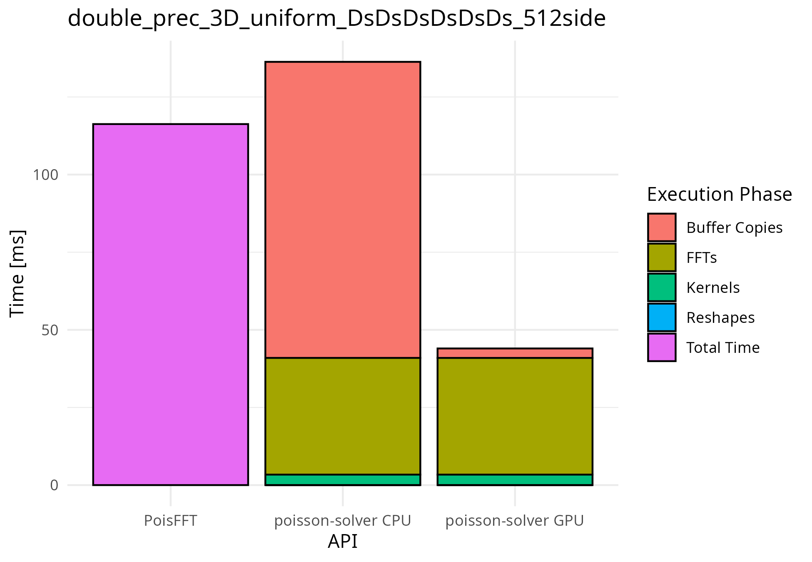
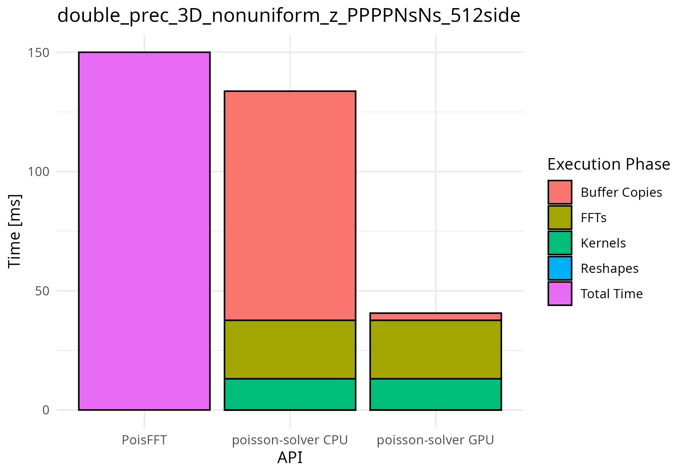
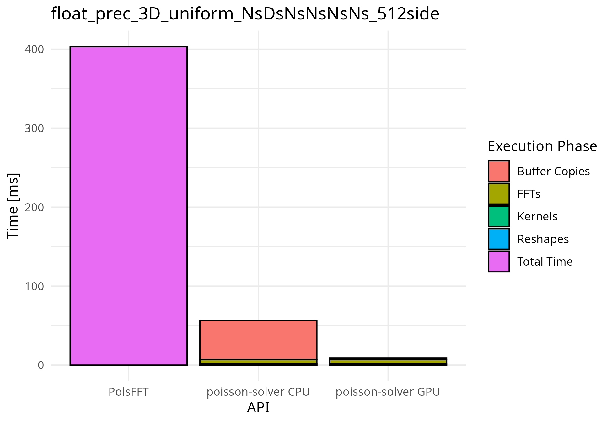
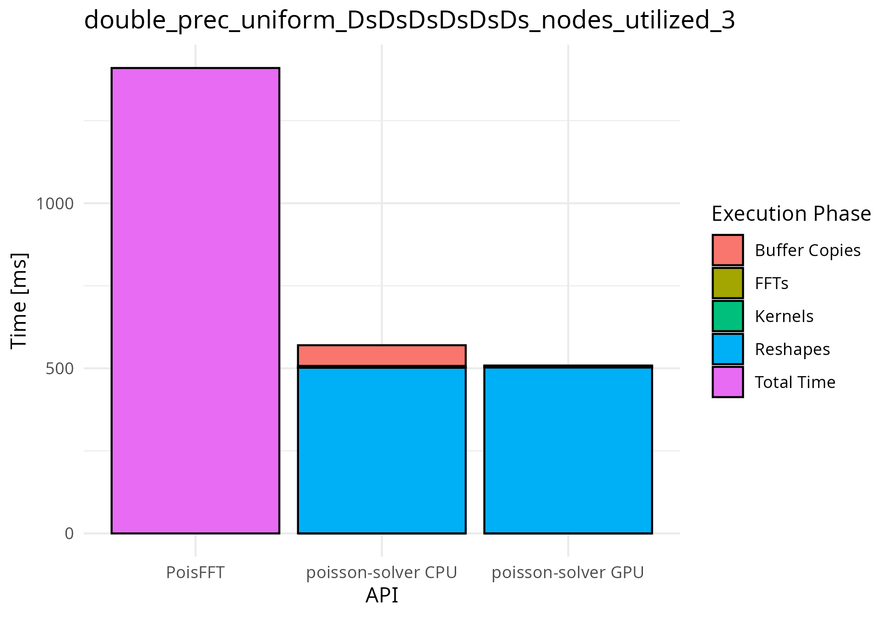
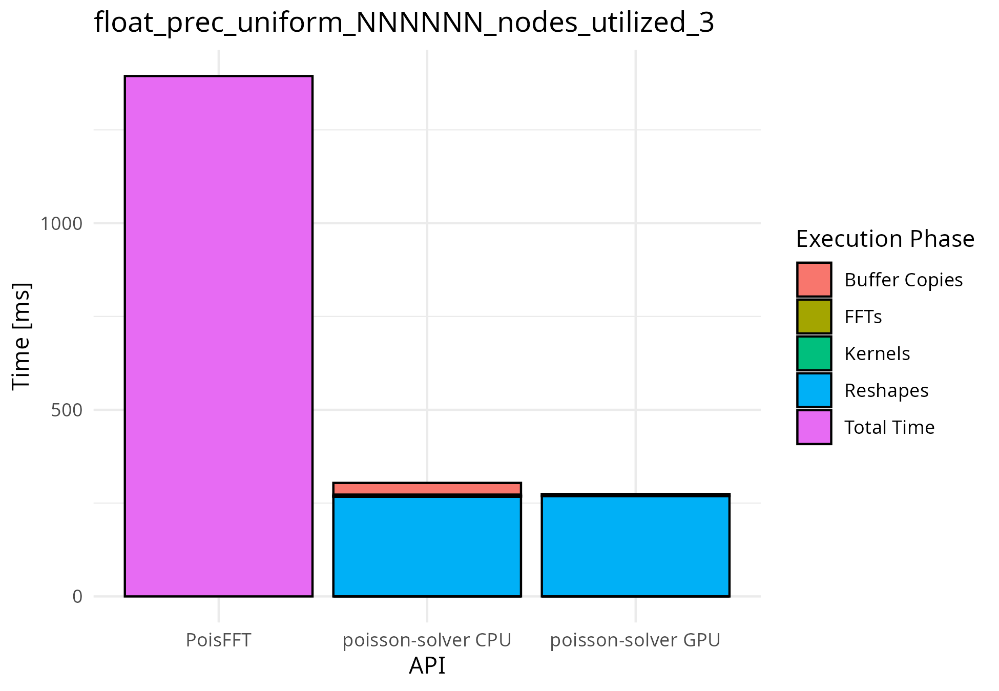
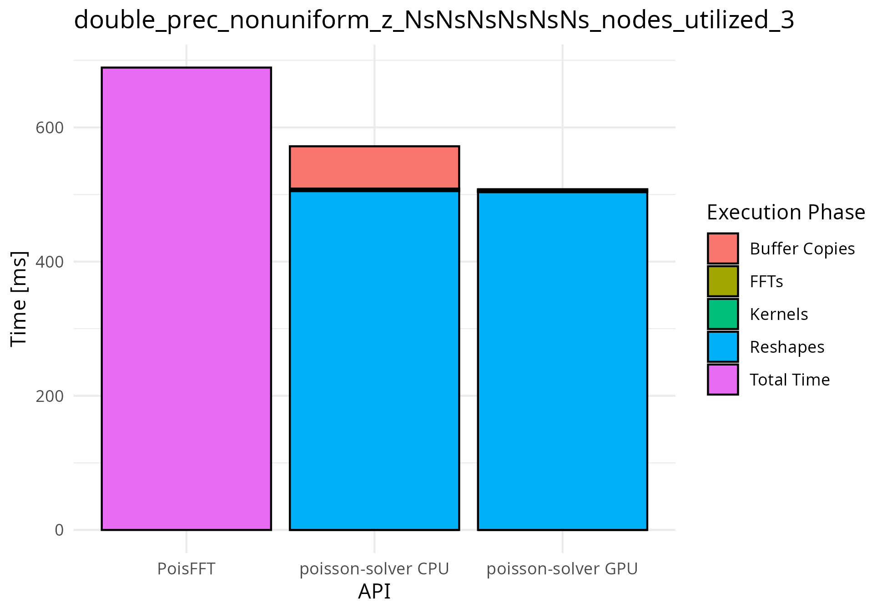

# Benchmark results

This directory contains comparison of `poisson-solver` against the original `PoisFFT`.
It also instructs on how to run the benchmarks.
It covers local (single-node) and distributed (multi-node) builds.
It stores the raw measurements, the processed speedup tables and a set of selected plots.

## The `PoisFFT` baseline

`PoisFFT` **is not a single-core reference here**.
During the measurements, `PoisFFT` was always allocated the maximum available resources (given the specific measurement scenario).
So every speedup number below compares against fully parallel, vectorized CPU code.
[Platform and processing method](#platform-and-processing-method) repeats the exact core and
process counts.

Every `PoisFFT` number in this directory comes from the fork [`mntjams/PoisFFT`](https://github.com/mntjams/PoisFFT), not from upstream `PoisFFT`.
The fork exists for two reasons.
First, upstream `PoisFFT` did not link and initialize `fftw` correctly for single precision, which made its `float` runs slower than they should be.
Second, the fork adds the benchmark programs and runner scripts that produce the CSV layout described in this file — upstream has no equivalent.
Reproducing the `PoisFFT` side of these benchmarks means cloning that fork and using its own scripts.
The scripts in `../benchmark-runners/` drive `poisson-solver` only.
However, the scripts for `PoisFFT` are nearly identical in structure and functionality.

## Performance summary
This is just a short summary of the speedups for a quick reference.
More detailed view is presented later.

A speedup is the `PoisFFT` time divided by the `poisson-solver` time.
A value above 1 means `poisson-solver` is faster.

The table gives the median speedup over all tested boundary conditions, uniformities and precisions.
The local row uses only the 3D results. The distributed results are also 3D.
All three rows use a $`512^3`$ grid.
The difference between GPU and CPU API is that GPU API performs no host-device copies, while the other API does.
CPU API accepts host buffers, GPU API accepts device buffers.
**Both solve on the GPU.**

| Scenario                        | GPU API | CPU API |
|---------------------------------|---------|---------|
| Local, one GPU                  | 5.8x    | 1.35x   |
| Distributed, one node           | 22.3x   | 4.4x    |
| Distributed, two or three nodes | 1.57x   | 1.43x   |

The speedup changes a lot with the boundary conditions and the grid size.
To get the speedup for a specific configuration, look it up in the [speedup tables](./tables/).
Refer to the [Decoding the data](#decoding-the-data) section if you need help reading the tables.

## What is where

`measured-data/` holds the raw, unprocessed measurements.
`tables/` and `plots/` hold output processed from those measurements.
See [Platform and processing method](#platform-and-processing-method) for the exact processing
steps.

| Path                                 | Contents                                                                                                  |
|--------------------------------------|-----------------------------------------------------------------------------------------------------------|
| `measured-data/local/`               | `poisson-solver` CSVs + `PoisFFT` CSVs, grid sides 64 to 512                                              |
| `measured-data/distributed/`         | `strong_scaling/` and `weak_scaling/`                                                                     |
| `measured-data/elmm/`                | `elmm-local.txt`, `elmm-distributed-only-mpi.txt`, `elmm-distributed-hybrid.txt` — whole-model wall clock |
| `plots/local/`, `plots/distributed/` | 3 + 3 selected bar plots, discussed in [Plots](#plots)                                                    |
| `tables/`                            | `local_speedup_table.csv` + `distributed_speedup_table.csv`                                               |

## Decoding the data

### Boundary-condition tokens

File names, CSV columns and the tables all name boundary conditions in an abbreviated form.
Use the table below to derive their meaning.

| File name | CSV `bc_name` / tables | Meaning                   |
|-----------|------------------------|---------------------------|
| `P`       | `P`                    | Periodic                  |
| `D`       | `D`                    | Dirichlet                 |
| `N`       | `N`                    | Neumann                   |
| `DS`      | `Ds`                   | Dirichlet, staggered grid |
| `NS`      | `Ns`                   | Neumann, staggered grid   |

File names use upper case (`DS`, `NS`).
The CSV `bc_name` column and the tables use mixed case (`Ds`, `Ns`).

The tokens name axis pairs in a fixed order: `{west, east}, {south, north}, {bottom, top}`.
So a 3D BC string of `PPPPNSNS` means periodic X, periodic Y, and staggered Neumann Z.
See [docs](../docs/docs.md#4-boundary-condition-dispatch-table) for the FFT transform each pair selects.

### Local file names

```
poisson-solver_local_<prec>_dim<N>_<api_type>_<uniformity>_<BCs>.csv
poisfft_local_<prec>_dim<N>_<uniformity>_<BCs>.csv
```

`api_type` of `nogpu` means the default API accepting host buffers.
`api_type` of `gpu` means the GPU API accepting device buffers (and therefore performing no host<->device copies).
One file holds every grid side from 64 to 512, in steps of 64.

`uniformity` specifies whether the grid was uniform or had nonuniform Z axis.

### Distributed file names

Distributed file names add `_N<nodes>_T<procs>` to the same pattern.
`poisson-solver` runs one process per GPU.
`PoisFFT` runs one process per CPU core.
We compare in terms of node utilization to keep it reasonably fair:

| Node utilization | Nodes | `poisson-solver` processes | `PoisFFT` processes |
|------------------|-------|----------------------------|---------------------|
| 0.25             | 1     | 1 (`T1`)                   | 8 (`T8`)            |
| 0.5              | 1     | 2 (`T2`)                   | 16 (`T16`)          |
| 1                | 1     | 4 (`T4`)                   | 32 (`T32`)          |
| 2                | 2     | 6 (`T6`)                   | 48 (`T48`)          |
| 3                | 3     | 8 (`T8`)                   | 64 (`T64`)          |

Watch for the collision: `T8` names 8 GPU processes for `poisson-solver`, but 8 CPU processes for `PoisFFT`.
Always read the `N` prefix together with `T`.
For example `N2_T6` means six processes (in total) running on two nodes.

Strong scaling fixes the global grid at $`512^3`$ for every node utilization.
Weak scaling grows the global grid — sides 161, 203, 256, 323 and 369 — to keep the work per node constant.

### CSV columns

`poisson-solver` local:
```
dim,precision,solver_type,api,bc_name,grid_size,iteration,copy_time_ms,reshape_time_ms,fft_time_ms,kernel_time_ms,outside_time_ms,sum_time_ms
```

The `outside_time_ms` contains the timing overhead and was thus left unused during the processing.
`sum_time_ms` is the times sum of individual phases and is used as the total.

`PoisFFT` carries only a total:
```
dim,precision,solver_type,api,bc_name,grid_size,iteration,total_execution_ms
```

Both solvers in distributed configuration add `num_procs` after `bc_name`.
Each distributed row reports the worst (slowest) process of that iteration.

The phase columns match `ExecutionTimes` in `include/poisson-solver/solver.hpp`:

- `copy` is host-device or device-device transfer of the input buffer
- `reshape` is redistribution of data between processes (one exception - see the rules for reading below),
- `fft` is the transform itself (one exception - see the rules for reading below), and
- `kernel` is the eigenvalue division or tridiagonal Z solver.

Three rules for reading these columns:

1. **Use `sum_time_ms`.** It is the total used throughout `tables/` and `plots/`.
   `outside_time_ms` is the benchmark's own wall clock and contains timing overhead.
2. **`reshape_time_ms` is always `0` in local builds.** The local build uses a no-op reshaper.
3. **Fully periodic distributed runs report `reshape_time_ms = 0` and a large `fft_time_ms`.**
   heFFTe (the FFT library for distributed builds) performs the redistribution
   inside the same call as the transform for this BC
   combination, so the two phases merge into one number. For example,
   `..._uniform_PPPPPP_N3_T8.csv` reports a 0.0 ms reshape and an average 1954.5 ms FFT. Do not read the
   0 ms as free communication — it is hidden inside the FFT time.

## Platform and processing method

The benchmarks were executed on a MFF UK `chimera` cluster.
`bw01` was used for the local benchmarks and `volta`s for the distributed benchmarks.

| Role        | Node(s)              | GPU                                                             | CPU                               | RAM    |
|-------------|----------------------|-----------------------------------------------------------------|-----------------------------------|--------|
| Local       | `bw01`               | 2x NVIDIA RTX PRO Blackwell Server Edition, 96 GB (only 1 used) | AMD EPYC 9454, 48 cores           | 768 GB |
| Distributed | `volta02`, `volta03` | 2x NVIDIA V100 PCIe, 16 GB                                      | Intel Xeon Silver 4110, 2x8 cores | 192 GB |
| Distributed | `volta05`            | 4x NVIDIA V100 SXM2, 32 GB                                      | Intel Xeon Gold 5218, 2x16 cores  | 384 GB |

CUDA 12.9 was used for the benchmarks.
The `volta` nodes connect over 10Gb Ethernet, with no InfiniBand.

`measured-data/` holds the raw, unprocessed measurements.
Every row is one iteration of one run, exactly as the benchmark executable wrote it.
Nothing there is averaged or filtered.
Two facts the tables do not carry on their own:

- **Local** `PoisFFT` ran with a fixed 48 cores.
- **Distributed** `PoisFFT` used the process counts in the node-utilization table above (see [Distributed file names](#distributed-file-names)).

`tables/` and `plots/` hold output processed from that raw data, through these steps:

1. **Measure.** Local runs do 75 iterations per grid size. Distributed runs do 30.
2. **Discard warm-up iterations.** 2 for local runs, 4 for distributed strong scaling, 6 for weak
   scaling. The first iterations pay for FFT planning and allocation.
3. **Discard outliers.** Drop any remaining iteration more than 3σ from the mean of that run.
4. **Average what remains.** This gives one number per configuration: `sum_time_ms` for
   `poisson-solver`, `total_execution_ms` for `PoisFFT`. The plots show this average, split by
   phase for `poisson-solver`.
5. **Divide to get the speedup.** `tables/` divides the `PoisFFT` average by the `poisson-solver`
   average. A speedup above 1 means `poisson-solver` is faster.

## Results

### Local

Speedups across every boundary condition, precision and grid size, by dimension (median, with the 25th–75th percentile range in parentheses):

| Dim   | Grid Sizes        | CPU API speedup    | GPU API speedup    | GPU API maximum   |
| ----- | ----------------- | ------------------ | ------------------ | ----------------- |
| 1     | 64 to 512         | 0.04 (0.03–0.07)   | 0.06 (0.04–0.10)   | 1.15              |
| 2     | $`64^2`$ to $`512^2`$ | 9.3 (3.8–23.2)     | 22.8 (7.3–51.7)    | 649               |
| 3     | $`64^3`$ to $`512^3`$ | 1.17 (0.75–1.80)   | 5.1 (2.4–10.4)     | 113               |

- **1D:** `PoisFFT` wins almost everywhere. Only 1 of 144 configurations reaches a GPU API
   speedup above 1 (float, `N | N`, side 448, 1.15x). GPUs bring no benefit for grids of this size.
- **2D:** At side 64 the GPU API speedup ranges 0.38–1.88.
   From side 128 upward the minimum is 1.77 and the speedups mostly grow with the grid size.
- **3D:** The GPU API always wins. Its minimum is 1.14, across all configurations. The CPU
   API loses in 40% of 3D configurations, because the host-device copy costs more than the GPU
   saves.

### Distributed

Fixed $`512^3`$ grid, by node utilization (median, with the 25th–75th percentile range):

| Node utilization | CPU API speedup  | GPU API speedup  |
|------------------|------------------|------------------|
| 0.25             | 4.4 (3.4–5.4)    | 28.1 (24.1–39.2) |
| 0.5              | 4.1 (3.4–5.4)    | 19.6 (17.1–27.1) |
| 1                | 4.4 (4.2–6.6)    | 20.7 (19.1–31.5) |
| 2                | 1.50 (1.40–2.78) | 1.63 (1.56–3.33) |
| 3                | 1.39 (1.31–2.36) | 1.49 (1.39–2.60) |

- `poisson-solver` is faster in all 140 distributed configurations. The minimum speedup is 1.11.
- **Reshapes dominate once the job crosses nodes.** At 3-node utilization, reshaping is most
   of the total time.

### ELMM

These runs measure the whole model, `ELMM` (or `gpu-elmm`), not the solver alone.
**Solver** is the wall clock spent inside the Poisson solver, and **Total** is the wall clock of all time steps.
We altered the `channel` example from the `ELMM` repository and measured it.
The changes of `channel` are noted above each table along with cluster configuration.

Local — $`512^3`$ grid, end time 0.1, node `bw01`, 48 cores for `ELMM` + `PoisFFT`:

| Boundary conditions | Solver: `PoisFFT` | Solver: `poisson-solver` | Solver speedup | Total: `PoisFFT` | Total: `poisson-solver` | Total speedup |
|---------------------|-------------------|--------------------------|----------------|------------------|-------------------------|---------------|
| Full periodic       | 35.61 s           | 28.34 s                  | 1.26x          | 459.48 s         | 448.83 s                | 1.02x         |
| PPNs                | 35.61 s           | 27.80 s                  | 1.28x          | 472.75 s         | 460.62 s                | 1.03x         |
| Full NeumannStag    | 46.96 s           | 26.03 s                  | 1.80x          | 514.01 s         | 489.41 s                | 1.05x         |

Distributed, pure MPI paralelization of `ELMM` (and `gpu-elmm`) — $`256^3`$ grid, end time 0.5, nodes `volta[02,03,05]`, 64 processes for `ELMM` +
`PoisFFT` against 8 processes (one GPU each) for `gpu-elmm` + `poisson-solver`:

| Boundary conditions | Solver: `PoisFFT` | Solver: `poisson-solver` | Solver speedup | Total: `PoisFFT` | Total: `poisson-solver` | Total speedup |
|---------------------|-------------------|--------------------------|----------------|------------------|-------------------------|---------------|
| Full periodic       | 175.22 s          | 159.75 s                 | 1.10x          | 328.82 s         | 968.96 s                | 0.34x         |
| PPNs                | 93.47 s           | 71.98 s                  | 1.30x          | 246.40 s         | 862.70 s                | 0.29x         |
| Full NeumannStag    | 96.48 s           | 42.51 s                  | 2.27x          | 252.50 s         | 810.58 s                | 0.31x         |

Distributed, hybrid MPI + OpenMP paralelization of `ELMM` (and `gpu-elmm`) — same $`256^3`$ grid, same nodes, both now run 8 processes, 8 CPUs each,
one GPU each for `gpu-elmm` + `poisson-solver`:

| Boundary conditions | Solver: `PoisFFT` | Solver: `poisson-solver` | Solver speedup | Total: `PoisFFT` | Total: `poisson-solver` | Total speedup |
|---------------------|-------------------|--------------------------|----------------|------------------|-------------------------|---------------|
| Full periodic       | 380.44 s          | 165.60 s                 | 2.30x          | 568.24 s         | 355.67 s                | 1.60x         |
| PPNs                | 177.25 s          | 75.44 s                  | 2.35x          | 363.61 s         | 255.58 s                | 1.42x         |
| Full NeumannStag    | 244.53 s          | 47.64 s                  | 5.13x          | 415.76 s         | 226.83 s                | 1.83x         |

The table below compares the best `ELMM` + `PoisFFT` setup against best `gpu-elmm` + `poisson-solver` setup:

| Boundary conditions | Best `ELMM` + `PoisFFT` | Best `gpu-elmm` + `poisson-solver` | Speedup   |
|---------------------|-------------------------|------------------------------------|-----------|
| Full periodic       | 328.82 s                | 355.67 s                           | 0.92x     |
| PPNs                | 246.40 s                | 255.58 s                           | 0.96x     |
| Full NeumannStag    | 252.50 s                | 226.83 s                           | **1.11x** |

Pairing `poisson-solver` with pure MPI `gpu-elmm` forces a choice: match processes to GPUs and leave most CPU
cores idle, or add more processes per GPU and make them fight over it. More processes make the CPU
part of `gpu-elmm` faster, but GPU contention then slows the solver down. We did not find a process
count that gave both a fast `gpu-elmm` and low GPU contention at the same time.

Hybrid MPI + OpenMP parallelism looked like the way out, since it trades processes for CPU threads.
It recovers nearly all of the 3x loss, and wins for one of three
boundary conditions. But `ELMM`'s own hybrid code runs slower than its pure-MPI code at the same
64-core budget, so `gpu-elmm` + `poisson-solver` in hybrid mode still looses to `ELMM` + `PoisFFT`'s
best configuration overall.
Porting more of `ELMM` to the GPU would remove this trade-off.

We can thus conclude the following:
- **The solver gets faster in all cases**,
- **Locally, the total is better by a few percent** — 1.02x to 1.05x. The solver is only about 8% of a local
  time step, so even a 1.8x solver speedup barely shows up in the total.
- **Distributed, pure MPI paralelization, matching processes to GPUs, the total gets about 3x worse** — even though the
  solver wins every time. The rest of `gpu-elmm` is CPU code, and `gpu-elmm` runs it on 8 processes
  instead of 64. There is no middle ground where `gpu-elmm` + `poisson-solver` win.
- **Distributed, hybrid paralelization, the total nearly recovers, and once passes the baseline** — 0.92x, 0.96x,
  and 1.11x against `ELMM` + `PoisFFT`'s own best configuration.

## Plots

All plots use the same layout:

- **Title:** Decode it as shown in [Decoding the data](#decoding-the-data).
  Local names end with the grid side (`_512side`).
  Distributed names end with the node utilization (`_nodes_utilized_3`).
- **X axis (`API`):** one bar for each solver.
  - `PoisFFT` is the CPU baseline.
  - `poisson-solver CPU` is the default API, which accepts host buffers (`nogpu` in file names).
    It still solves on the GPU. The label names where the input and output buffers are.
  - `poisson-solver GPU` is the GPU API, which accepts device buffers (`gpu` in file names).
- **Y axis (`Time [ms]`):** the average time of one solve, in milliseconds. The average comes
  from steps 1–4 in [Platform and processing method](#platform-and-processing-method). The scale
  is linear, starts at 0, and is different in each plot. Compare bar heights only inside one plot.
- **Colors (`Execution Phase`):** each `poisson-solver` bar is a stack of its phases:
  `Buffer Copies` (`copy_time_ms`), `FFTs` (`fft_time_ms`), `Kernels` (`kernel_time_ms`) and
  `Reshapes` (`reshape_time_ms`). The stack height is `sum_time_ms`. `Total Time` is the single
  `PoisFFT` bar (`total_execution_ms`), because `PoisFFT` gives no phase breakdown.

`plots/local/` shows results for a $`512^3`$ grid.


`poisson-solver` does not always win when host-device copies take place.


The nonuniform-Z solver.
The tridiagonal Z kernel takes far more than that of a uniform solve, so kernel time is visible in this plot.


The best local 3D case of these three.

`plots/distributed/` shows 3-node-utilization results: 8 GPU processes against 64 `PoisFFT`
processes.


Reshapes are 99% of the GPU API total (503 of 509 ms). FFT takes 4 ms. Overall speedup: 2.8x.


The best distributed case in 3-node utilization, 5.1x. Still reshape-bound: 269 of 274 ms.


The narrowest margin of the three shown, 1.36x.

Buffer copies are the local bottleneck.
The distributed bottleneck is hard to determine.
The reshape cost measured here is the 10Gb Ethernet.
Running these benchmarks on an InfiniBand setup would show the distributed bottleneck far more clearly.

## Running the benchmarks

### Build

The `benchmarks` target and its timer instrumentation exist only when configured with
`-DPOISSON_SOLVER_ENABLE_BENCHMARKS=ON`, reachable through the `release-benchmarks` or
`release-mpi-benchmarks` presets. See [../examples/README.md](../examples/README.md#how-to-build)
for the full preset list.

### Container

The benchmark launchers assume you work inside the container environment (described [here](../container-environment/)) **on the `chimera` cluster**.
Adjust the `SLURM` launchers in the benchmark scripts to accommodate your cluster setup.

### Launcher/runner scripts

All six scripts live in `../benchmark-runners/`.
There are three _launchers_ (designed to run from the head node).
These launchers use `SLURM` to allocate a worker node and hand off work to the benchmark _runners_.
The runners (there are also three of them) then loop over all the configurations and execute the benchmark binary with each configuration.
The results are by default stored into `build/tests/benchmarks/results/` but have been copied here and put under version control.

| Launcher                           | Runner                         | Results copied into                                        |
|------------------------------------|--------------------------------|------------------------------------------------------------|
| `run_local_benchmarks.sh`          | `local_benchmarks.sh`          | `measured-data/local/poisson-solver/`                      |
| `run_strong_scaling_benchmarks.sh` | `strong_scaling_benchmarks.sh` | `measured-data/distributed/poisson-solver/strong_scaling/` |
| `run_weak_scaling_benchmarks.sh`   | `weak_scaling_benchmarks.sh`   | `measured-data/distributed/poisson-solver/weak_scaling/`   |

Things to know before running benchmarks:

- **Do not run them from inside `benchmark-runners/`.** The launcher scripts expect
  to be executed from the directory that holds `mapped/` and `imgdir` (again, see [container environment](../container-environment/)).
- **Node names are hardcoded.** `run_local_benchmarks.sh` sets `NODE="bw01"`, and the scaling
  launchers set `CONFIGS` to `volta[02,03,05]`. Edit these to target a different cluster.
- **A configuration whose output CSV already exists is skipped.** Delete the CSV to re-run that
  configuration. The scripts write into `build/tests/benchmarks/results/`, not into this
  directory — copying results here is a manual step.

### Running the executable directly

You do not need the launcher/worker pair to measure one configuration.
On an already-allocated GPU node (or a local machine supporting the [requirements](../README.md#requirements)), calling the executable directly is the fastest way to do this.
Assuming you built the benchmarking code correctly:
```
build/tests/benchmarks/benchmarks <float|double> <dim> <use_gpu_api> <use_nonuniform_z> \
    <iterations> <grid_side_size_begin> <grid_side_size_end> <grid_side_size_step> \
    <out_file> [nps_y nps_z] BC_1 BC_2 ...
```

`nps_y nps_z` apply only to the MPI build.
`use_gpu_api` and `use_nonuniform_z` accept `yes/no`.
Exactly `2*dim` BC tokens must follow, in upper case (see [Boundary-condition tokens](#boundary-condition-tokens)).

Example — local, 3D, double precision, GPU API, uniform grid, 75 iterations, sides 64 to 512 in steps
of 64, fully periodic:

```bash
build/tests/benchmarks/benchmarks double 3 yes no 75 64 512 64 out.csv P P P P P P
```

Example of distributed invocation:
```bash
# Assuming you allocated four processes beforehand
# (e.g., run `salloc` and then prefix the following command with `srun --mpi=pmix`)
build/tests/benchmarks/benchmarks double 3 yes no 75 64 512 64 out.csv 2 2 P P P P P P
```

This overwrites `out.csv` if it already exists, unlike the launcher/worker scripts, which skip
an existing output file.
